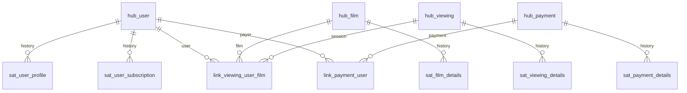

# Data Vault: «КиноДляВсех»

Домашнее задание OTUS, занятие 9 нового потока: логическая модель DWH онлайн-кинотеатра. Реализация структуры для PostgreSQL находится в `schema.sql`.

## Предположения и гранулярность

Вводятся стабильные исходные ID: user_id, film_id, viewing_id, payment_id. Повторный просмотр того же фильма тем же пользователем получает отдельный viewing_id. Платёж — отдельная операция со своим payment_id, а не сумма за пользователя/дату. Один просмотр относится к одному пользователю и фильму, один платёж — к одному пользователю. Возврат учитывается отдельной платёжной операцией или новой версией статуса, согласно контракту источника. Платёж не связывается с конкретным фильмом: в условии оплачивается подписка.

Бизнес-ключ каждого Hub: строка `source_system:entity_id`, например `cinema:42`. Email, телефон, имя и название фильма не являются бизнес-ключами: они могут меняться и совпадать. Источник входит в ключ, чтобы ID разных систем не сталкивались.

## Ключи и служебные поля

- `*_bk` — бизнес-ключ из источника, уникален в Hub.
- `*_hk` — технический ключ SHA-256 (64 hex-символа); для Hub вычисляется из канонического BK, для Link — из упорядоченного набора HK участников. Префиксы сущностей и однозначное кодирование длины частей исключают неоднозначность склейки. Алгоритм и регистр ID фиксируются контрактом, значимые пробелы ID не удаляются без правила источника.
- `load_dts` — время загрузки в UTC, `record_source` — происхождение записи (система/поток).
- `hashdiff` — SHA-256 канонического набора описательных атрибутов Satellite (NULL и пустая строка различаются).
- `effective_from` — время начала действия версии по данным источника; отличается от времени получения.
- PK Satellite: `(parent_hk, load_dts)`. При нескольких изменениях одного родителя в одну микросекунду загрузчик назначает уникальное время или расширяет PK номером версии. Одно и то же неизменённое состояние повторно не загружается.

## Каталог таблиц

| Таблица | Назначение, бизнес-ключ / технический PK | Связи и атрибуты |
|---|---|---|
| hub_user | Идентичность пользователя; user_bk / user_hk | Родитель двух пользовательских Satellite |
| hub_film | Идентичность фильма; film_bk / film_hk | Родитель sat_film_details |
| hub_viewing | Идентичность отдельного сеанса; viewing_bk / viewing_hk | Родитель sat_viewing_details |
| hub_payment | Идентичность платёжной операции; payment_bk / payment_hk | Родитель sat_payment_details |
| link_viewing_user_film | Связь сеанса, пользователя и фильма; отдельного BK нет / viewing_user_film_hk | FK viewing_hk, user_hk, film_hk; UNIQUE на тройку |
| link_payment_user | Связь платежа и плательщика; отдельного BK нет / payment_user_hk | FK payment_hk, user_hk; UNIQUE на пару |
| sat_user_profile | История профиля; составной PK user_hk + load_dts | ФИО, дата рождения, email, телефон, дата регистрации, страна проживания |
| sat_user_subscription | История подписки; составной PK user_hk + load_dts | Тип подписки: обычная/детская |
| sat_film_details | История свойств фильма; film_hk + load_dts | Название, дата выхода, жанры, возрастное ограничение, длительность, страны производства, рейтинг |
| sat_viewing_details | История состояния сеанса; viewing_hk + load_dts | Начало, окончание, статус просмотра, устройство |
| sat_payment_details | История состояния платежа; payment_hk + load_dts | Дата, сумма, метод, статус, валюта |

У всех таблиц есть load_dts и record_source. У Satellite дополнительно hashdiff и effective_from. Полный набор столбцов и FK указан в DDL.

## Схема связей



Кардинальности показывают физические FK: каждая строка Satellite/Link ссылается ровно на одну строку соответствующего Hub. Правило «у сеанса один пользователь и фильм» проверяется контрактом загрузки. В Raw Vault ошибочные/исправленные связи сохраняют происхождение; при смене связи нужен effectivity Satellite, а не удаление старого Link.

## История и загрузка

1. Принять исходные записи в staging вместе с временем события и источником. Проверить наличие ID; записи без ID отправить в карантин.
2. Рассчитать Hub HK, вставить новые бизнес-ключи (существующие Hub не обновлять).
3. Рассчитать и вставить новые Link после загрузки всех родительских Hub.
4. Сравнить hashdiff с последней версией соответствующего Satellite. При изменении добавить строку, предыдущую не переписывать.
5. Для текущего состояния выбирать последнюю загруженную версию, для состояния на бизнес-дату учитывать effective_from и поздно пришедшие события.

Например, пользователь сначала имел обычную подписку, затем детскую: одна строка hub_user и две версии sat_user_subscription. Фильм просмотрен повторно — два hub_viewing и две связи с теми же user_hk и film_hk. Платёж сначала pending, затем paid — один hub_payment и две версии sat_payment_details.

Профиль и подписка разделены из-за разной частоты изменения и чувствительности персональных данных. Жанры/страны представлены массивами как свойства фильма; если ими нужно управлять как независимыми бизнес-сущностями, их следует вынести в отдельные Hub/Link. Значения статусов сохраняются из источника, правила допустимости и нормализация относятся к staging/Business Vault; жёсткие CHECK на статусы в Raw Vault не установлены, чтобы не терять новые коды источника.

## Проверка структуры

DDL запускается один раз в пустой БД PostgreSQL:

```powershell
docker cp .\schema.sql otus05-pg-shop:/tmp/cinema-schema.sql
docker exec otus05-pg-shop psql -X -U postgres -d shop -v ON_ERROR_STOP=1 -f /tmp/cinema-schema.sql
docker exec otus05-pg-shop psql -X -U postgres -d shop -c '\dt cinema_vault.*'
```

Модель не требует загрузки реальных персональных/платёжных данных. Для задания предоставлены все сущности, атрибуты, ключи, связи и диаграмма.

Методологическая справка: [AutomateDV — Links](https://automate-dv.readthedocs.io/en/latest/tutorial/tut_links/), [правила загрузки Hub/Link/Satellite](https://automate-dv.readthedocs.io/en/v0.10.0/best_practises/loading/).

Фактическая проверка 16.10.2026: DDL выполнен PostgreSQL 16.15 без ошибок, создано 11 таблиц в cinema_vault (4 Hub, 2 Link, 5 Satellite); все внешние ключи приняты СУБД.
