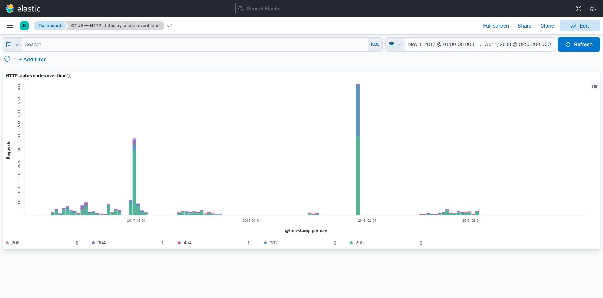

# ELK: исправленный разбор даты и HTTP-статусов

ДЗ OTUS, занятие 16. Доработка собственного https://github.com/gorlanova-de-lab/elk_demo по замечанию преподавателя: дата события должна сохраняться и корректно попадать в @timestamp.

## Исправления

- Исходные timestamp и request сохранены. Из копии parsed_timestamp убираются скобки.
- date использует dd/MMM/yyyy:HH:mm:ss, locale en. В исходнике часовой пояс отсутствует; явно принято UTC. Поэтому это допущение интерпретации, а не восстановленная из файла зона.
- Основное поле статуса называется status_code. До преобразования в integer проверяется трёхзначный HTTP-статус 100–599.
- Строка заголовка исключается. Повреждённые строки (ошибки CSV/даты/HTTP request/статуса) сохраняются в отдельном weblogs-rejected-v2 и не попадают в дашборд.
- Корректные документы идут в weblogs-v2-yyyy.MM.dd по дате события, а не загрузки.
- Сервисы Elasticsearch/Kibana 7.14.1 привязаны к localhost. Logstash запускается отдельно, читает только clickstream.conf, позиция чтения сохраняется в named volume sincedb.

## Фактическая проверка 17.10.2026

Источник weblog.csv: 16007 строк данных (заголовок отдельно).

| Результат | Число |
|---|---:|
| Корректные HTTP-запросы | 15789 |
| Повреждённые строки в карантине | 218 |
| Всего | 16007 |
| HTTP 200 | 11330 |
| HTTP 302 | 3498 |
| HTTP 304 | 658 |
| HTTP 404 | 251 |
| HTTP 206 | 52 |

Период корректных событий: 2017-11-07 23:59:19 UTC — 2018-03-02 15:47:46 UTC. Значений 0/2017/2018 в HTTP-статусах основного индекса нет. Фактический ответ Elasticsearch сохранён в verification.json.



## Воспроизведение

```powershell
docker compose up -d elasticsearch kibana
docker compose --profile load up -d logstash
docker compose logs -f logstash
```

Дождаться обработки всех строк (по _count корректного индекса и rejected сумма 16007); затем можно остановить только загрузчик: docker compose stop logstash. Повторный запуск с тем же CSV и сохранённым sincedb не перечитывает его. При замене CSV/удалении sincedb возможна повторная загрузка: не удалять volume без намерения пересоздать учебные данные.

В Kibana http://localhost:5601 → Stack Management → Saved Objects → Import загрузить dashboard.ndjson (с зависимостями). Открыть Dashboard «OTUS — HTTP status by source event time». Он хранит абсолютный диапазон 01.11.2017–01.04.2018, а не Last 15 minutes. График: count по @timestamp (день), stacked-разбиение по status_code. В UI время может отображаться в часовом поясе браузера.

Для проверки:

```powershell
Invoke-RestMethod 'http://localhost:9200/weblogs-v2-*/_count'
Invoke-RestMethod 'http://localhost:9200/weblogs-rejected-v2/_count'
```

Исходный файл и конфигурация включены. Старые скриншоты исходного репозитория не являются подтверждением этой доработки; актуальный снимок — dashboard.png.

