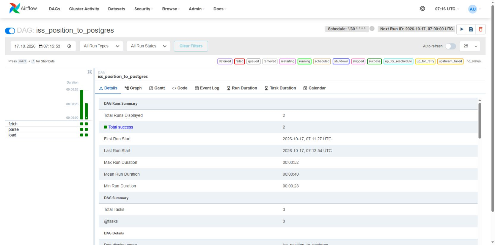

# Положение МКС: API → Airflow → PostgreSQL

ДЗ занятия 22. DAG `iss_position_to_postgres`: три отдельных task `fetch → parse → load`, расписание каждые 30 минут, catchup=False, retries=2. Источник из условия: http://api.open-notify.org/iss-now.json. URL можно изменить через ISS_API_URL, чтобы подставить локальный тестовый API. На 17.10.2026 исходный endpoint ответил message=success.

Проверяется HTTP-ответ, статус API, свежесть timestamp (10 минут), диапазоны координат. В PostgreSQL сохраняется реальное время наблюдения, а не логическая дата Airflow. Запрос параметризован; PK по observed_at делает повторную загрузку одной точки идемпотентной. Хранятся время получения, run_id и границы периода, чтобы подтвердить разные запуски. Догонять прошлое текущими координатами нельзя: API не исторический.

## Локальный стенд

Скачанный `docker-compose.official.yaml` — официальный quickstart Apache Airflow 2.10.5, для обучения. Он запускает Airflow и служебный PostgreSQL; последний не подменяет требуемую облачную managed СУБД analytics.

```powershell
New-Item -ItemType Directory -Force dags,logs,plugins,config
docker compose -f docker-compose.official.yaml up airflow-init
docker compose -f docker-compose.official.yaml up -d
docker compose -f docker-compose.official.yaml exec airflow-scheduler airflow dags list-import-errors
```

UI: http://localhost:8080, учебный логин airflow / airflow. Не открывать этот учебный стенд в интернет с такими параметрами.

В UI Admin → Connections создать Connection Id `analytics_pg`, тип Postgres, host/port/db/login/password целевой БД. Для облака: БД analytics, private network/SSH-туннель или ограниченный доступ, TLS с проверкой сертификата согласно параметрам managed PostgreSQL. Секреты не класть в код или Git. Для локальной проверки можно использовать отдельную учебную PostgreSQL с базой analytics, доступную из сети Compose.

Включить DAG в UI. Дождаться более пяти реальных получасовых запусков (минимум шесть). Проверка:

```sql
SELECT observed_at,latitude,longitude,collected_at,dag_run_id,
       data_interval_start,data_interval_end
FROM iss_observations ORDER BY observed_at;
SELECT count(DISTINCT data_interval_start) AS periods FROM iss_observations;
```

## Облачное развёртывание и статус

17.10.2026 созданы новая VM Yandex Cloud и managed PostgreSQL17 с БД analytics. Подключение analytics_pg добавлено через UI, TLS verify-full проверен. Первый реальный облачный scheduled run записал точку11:31:39UTC. Ожидается накопление минимум6разных получасовых периодов; до этого ДЗ не отправляется. Локально также проверены >5периодов, но они не подменяют облачные. Не сдавать как завершённое ДЗ до восстановления облака, развёртывания, накопления данных и двух настоящих скриншотов (UI успешных runs и SQL в облачной СУБД).

Порядок после восстановления: использовать учебную VM, развернуть Airflow; создать/использовать managed PostgreSQL analytics; настроить analytics_pg через UI; скопировать DAG в dags; проверить import errors; включить; дождаться шести периодов; сохранить снимки. Версия 2.10.5 выбрана из ветки Airflow 2.x для актуального локального quickstart, вместо устаревшего 2.0 из текста задания.

[Официальный Docker quickstart Airflow 2.10.5](https://airflow.apache.org/docs/apache-airflow/2.10.5/howto/docker-compose/index.html).

## Проверенный локальный запуск 17.10.2026

Для текущего стенда используется docker-compose.local.yml: один Airflow standalone на localhost:8080 и analytics в локальном PostgreSQL сети otus-weather_default. Connection URI хранится только в .env. DAG без import errors. Получены два реальных успешных запуска (scheduled и manual), в БД сохранены две точки МКС с разными observed_at. Это один получасовой data_interval и не заменяет требование >5 периодов в облаке. Скриншот локального Airflow — local-runs.png; фактический вывод БД и списка runs — local-verification.txt. Оба запуска обращались к настоящему API, данные не синтезировались.

Файл iss_pipeline.py в корне — копия для публикации; для официального Compose скопировать его в dags/iss_pipeline.py. Для локального Compose нужен предварительно запущенный PostgreSQL и созданная analytics; этот стенд предназначен только для локальной проверки.





## Повторная локальная проверка

17.10.2026, последнее наблюдение 10:30:09 UTC: 9 строк за 8 разных получасовых периодов, failed DAG runs отсутствуют. Облачные запуски этим не подтверждаются. Для будущей VM добавлен docker-compose.cloud.yml: подключение analytics_pg нужно создать через UI, сертификат managed PostgreSQL монтируется из certs. SQL проверки — verify-cloud.sql. Конфигурация Compose проверена командой config --quiet без запуска ресурсов.

## Созданный облачный стенд

Ubuntu24.04,2vCPU8ГБRAM,HDD20ГБ,Airflow2.10.5 standalone в Docker; отдельный managed PostgreSQL17.11Yandex,1хостb2.medium,network-hdd10ГБ,БДanalytics. Метаданные самого Airflow — SQLite/SequentialExecutor, допустимые здесь только для учебного стенда. Данные МКС идут исключительно в managed PostgreSQL, не в контейнер BI.

Использован docker-compose.cloud.yml. В UI Admin → Connections:analytics_pg,типPostgres,порт6432,databaseanalytics;Extra sslmode=verify-full и sslrootcert=/opt/airflow/certs/YandexInternalRootCA.crt. Пароли и ключи в репозиторий не входят. Веб-порт8080 слушает толькоloopbackVM,доступ черезSSH-туннель.

По поручению пользователя после накопления данных, проверки и сохранения результатов оба облачных ресурса будут остановлены без удаления данных, для последующего обучения.
