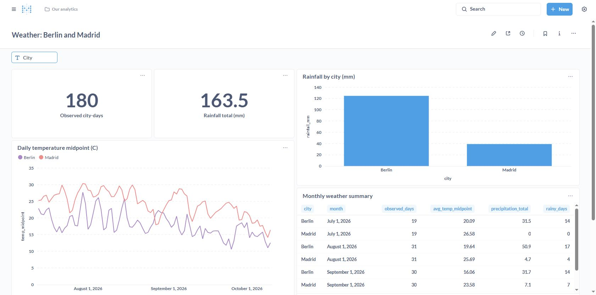
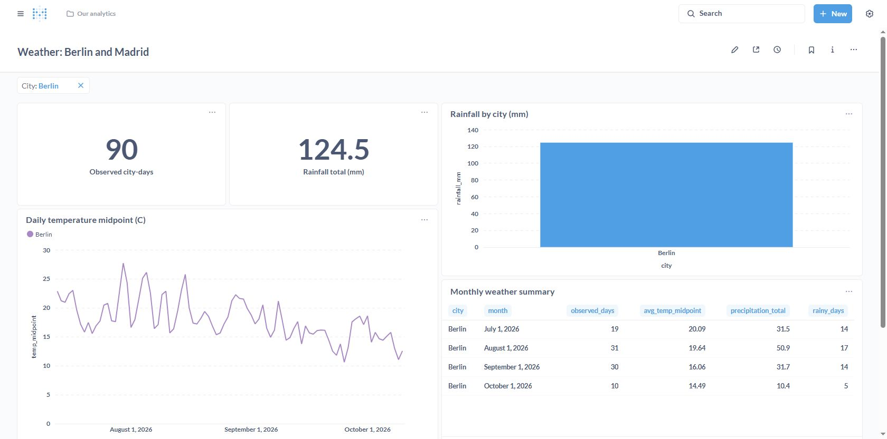
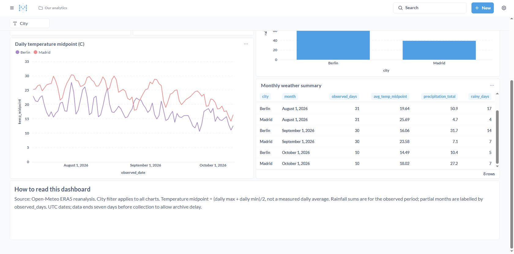

# Витрина + BI: погодная аналитика

ДЗ занятия 32. Metabase v0.56.5, PostgreSQL 16 и ETL развёрнуты и проверены в Docker на VM Yandex Cloud. Сохранён также локальный стенд. ДЗ пока не отправлено: карточка BI в OTUS ещё не открыта.

## Что построено

Источник — Open-Meteo Historical Weather API (ERA5). 180 city-days: Berlin и Madrid, по 90 дней 13.07.2026–10.10.2026. Данные загружены через код конвейера, сохранены в PostgreSQL; Metabase подключён к представлениям mart.weather_daily и mart.weather_monthly.

Дашборд Weather: Berlin and Madrid содержит:
- два числа: количество city-days, сумма осадков;
- линейный график температуры по городам;
- столбчатую диаграмму осадков;
- таблицу месячных показателей;
- фильтр City, подключённый ко всем пяти карточкам;
- текстовый блок с источником, правилами расчёта и ограничениями.

Температура midpoint — (максимум + минимум)/2, а не измеренная средняя температура суток. Месяцы на границах периода неполные, поэтому таблица показывает observed_days. Даты UTC.

## Проверка

На всех городах: 180 city-days, 163.5 mm осадков, 8 строк месячной таблицы.

Фильтр Berlin проверен в UI: 90 city-days, 124.5 mm, на графиках остаётся только Berlin. Все пять SQL карточек успешно выполнились через API.

## Воспроизведение и перенос

Локальное окружение, SQL-слои и скрипт воспроизводимого создания карточек включены в эту папку. Они также используются локальной заготовкой курсового проекта (его сдача пользователем отложена). Для Metabase используется docker-compose.yml; настройки UI воспроизводятся setup_metabase.py и dashboard-spec.json. Пароли хранятся только в локальном .env и не публикуются.

Облачный перенос выполнен 17.10.2026; новые подтверждения приведены ниже. После открытия карточки BI отправить ссылку и облачные скриншоты в OTUS. Локальный URL сейчас http://localhost:3000/dashboard/2 .

Для повторения: создать .env из .env.example, задать POSTGRES_PASSWORD и METABASE_PASSWORD (случайные строки), выполнить docker compose up -d --build, дождаться SUCCESS rows=180 в логах pipeline, затем docker compose run --rm --no-deps -e METABASE_URL=http://metabase:3000 -v "${PWD}:/app" pipeline python setup_metabase.py. Реальный .env в репозитории отсутствует. Логин локального Metabase otus@example.com, пароль — METABASE_PASSWORD из своего .env.

На 17.10.2026 пункт «9. Витрина + BI» в чате OTUS визуально неактивен и при нажатии не открывает форму. В сохранённых условиях указано: ДЗ откроется за два дня до занятия. После открытия и облачной проверки потребуется отправка; сейчас она не выполнена.

## Облачный стенд 17.10.2026

Развёрнут на Ubuntu 24.04 VM otus-homework в Yandex Cloud, ru-central1-d: 2 vCPU, 8 ГБ RAM, HDD 20 ГБ, Docker29.1.3 и Compose2.40.3. PostgreSQL16, ETL и Metabase запущены в Docker. Веб-порт3000 доступен только на loopback VM; доступ с компьютера — через SSH-туннель.

Два настоящих облачных запуска ETL успешны: 11:18:40 и11:21:07 UTC; по180 загруженных строк, после повтора staging остаётся180. Все5SQL карточек PASS, число city-days180, сумма осадков163.5мм. Облачные подтверждения хранятся отдельно от локальных: cloud-dashboard-all.png и cloud-dashboard-berlin.png. Отправка BI в OTUS ожидает открытия карточки задания.

По указанию пользователя после завершения проверки VM будет остановлена, данные и диск сохранятся для обучения. SSH-ключи и пароли в публичный репозиторий не входят. Стоимость работающей VM рассчитывается отдельно от хранения после остановки; ссылка localhost:13000 работает только при активном SSH-туннеле и запущенной VM.

Облачный Berlin:90city-days,124.5мм,4месячных строки. Протокол выполнения5карточек и повторной загрузки:cloud-verification.log.
