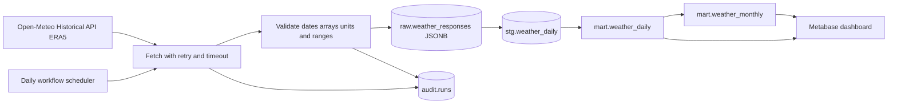
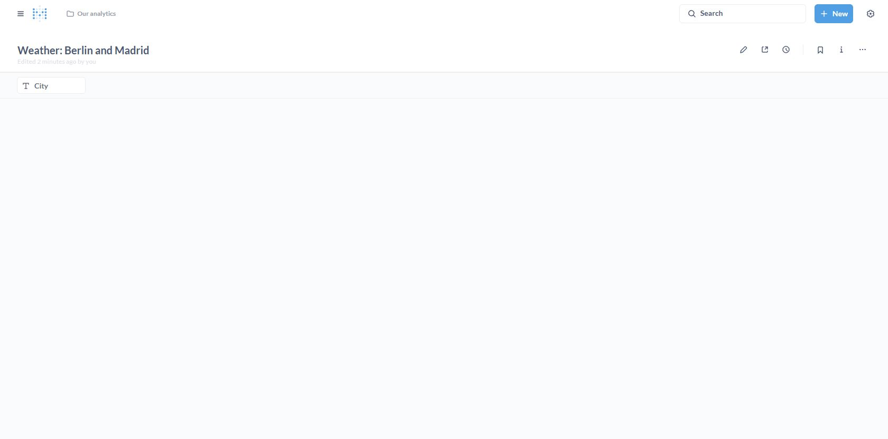
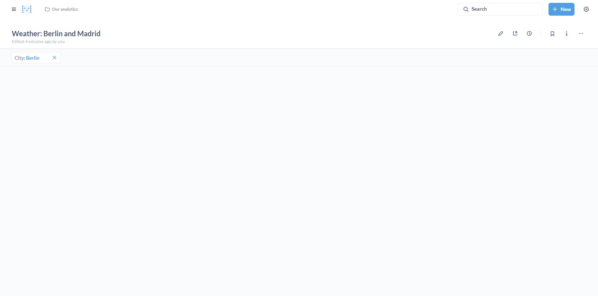

# Сбор и анализ погодных данных: от API до BI-дашборда

Учебное data-driven приложение: мониторинг погоды двух городов на основе внешнего API, многослойного хранилища PostgreSQL и дашборда Metabase. Тема согласована Вадимом Заигриным 30.10.2026. Проект подготовлен к проверке в OTUS.

## Бизнес-требования

Пользователь сравнивает температурный режим и осадки Berlin/Madrid за последние 90 доступных дней, видит динамику, месячные итоги и количество дней наблюдения. Дашборд фильтруется по городу. Цель - воспроизводимый аналитический процесс, а не прогноз или рекомендации для безопасности.

Критерии: ежедневное обновление, сохранение исходного JSON и происхождения данных, отсутствие дублей city/date при повторе, проверка качества, журнал успешных/ошибочных запусков, графики/таблица/KPI.

## Архитектура



Один контейнер pipeline оркестрирует последовательность fetch -> validation -> raw -> upsert staging -> представления mart -> audit. После запуска выполняется сразу, затем каждые 86400 секунд. Каждый запуск двух городов - одна транзакция: при ошибке изменения слоёв откатываются, audit получает failed. HTTP GET имеет timeout и три повтора для 429/5xx. До записи проверяются длины массивов, уникальность и полнота дат, отсутствие NULL/NaN, разумные диапазоны температуры, неотрицательные осадки, min ≤ max.

Staging сохраняет всю накопленную историю. Витрина mart.weather_daily выбирает последние 90 дней относительно самой поздней даты в staging, а mart.weather_monthly агрегирует только это окно. Поэтому после обновлений история растёт, но текущий дашборд содержит 180 city-days.

raw сохраняет полный ответ с hash содержимого daily и ссылкой на audit. Одинаковый daily повторно не размножает raw; staging имеет PK(city,observed_date), повтор обновляет значения. Представления mart автоматически показывают текущие очищенные данные. Персональные данные не используются.

## Состав

- schema.sql - создание схем raw/stg/mart/audit, таблиц и представлений;
- pipeline.py - внешняя загрузка, проверки, слои и расписание;
- Dockerfile, requirements.txt, docker-compose.yml - воспроизводимое окружение;
- setup_metabase.py - создание соединения и пяти карточек, фильтра City и комментариев;
- dashboard-spec.json - SQL и настройки карточек без секретов;
- test_validation.py - проверки ошибочных наблюдений;
- .env.example - имена локальных секретов (настоящий .env исключён).

## Запуск с нуля

Из этой папки в PowerShell создать .env на основе .env.example, заменив пароль случайной строкой. Добавить METABASE_PASSWORD со случайным сложным паролем; его использует скрипт локального Metabase. Не публиковать .env.

```powershell
docker compose up -d --build
docker compose logs -f pipeline
```

Дождаться SUCCESS rows=180. Создать дашборд (скрипт требует requests; удобно выполнить его в контейнере с уже установленными зависимостями):

```powershell
docker compose run --rm --no-deps -e METABASE_URL=http://metabase:3000 -v "${PWD}:/app" pipeline python setup_metabase.py
```

Локальный интерфейс: http://localhost:3000, логин otus@example.com, пароль METABASE_PASSWORD из своего .env. Это отдельный локальный учебный аккаунт. ID дашборда скрипт печатает в выводе; на проверенном стенде /dashboard/2. Порты PostgreSQL 5433 и Metabase 3000 доступны только с localhost. H2 для метаданных Metabase выбран для учебной локальной демонстрации; для многопользовательского продакшена нужен отдельный PostgreSQL и полноценная политика доступа/резервирования.

## Фактическая демонстрация 17.10.2026

- Внешний API успешно получен для двух городов, 13.07.2026–10.10.2026, по 90 дней.
- Два реальных запуска success по 180 записей; после второго в staging остаётся 180, а не 360: повторная загрузка не создаёт дубли.
- Тест validate_daily успешно отклоняет плохие диапазоны, отрицательные осадки, отсутствующие/NaN значения и неодинаковые массивы.
- Пять SQL-карточек Metabase реально выполнились, линейный график/столбцы/таблица/KPI отображены в UI.
- Все города: 180 city-days, 163.5 mm осадков. Фильтр Berlin: 90 city-days, 124.5 mm. Это историческая проверка. Актуальные подтверждения от 22.11.2026 находятся в этой папке: dashboard-all.jpg, dashboard-berlin.jpg и verification.json.

```powershell
docker compose exec -T postgres psql -U weather -d weather -c 'SELECT status,rows_loaded FROM audit.runs;'
docker compose exec -T postgres psql -U weather -d weather -c 'SELECT city,count(*) FROM stg.weather_daily GROUP BY city;'
docker compose run --rm --no-deps -v "${PWD}:/app" pipeline python test_validation.py
```

Для однократной загрузки конкретного периода: docker compose run --rm --no-deps pipeline python pipeline.py --once --start 2026-09-01 --end 2026-09-30.

## Расчёты и ограничения

Источник - ERA5 reanalysis, не показания конкретного бытового датчика. Последние семь дней исключаются из-за задержки архива. Суточные даты UTC. temp_midpoint=(temp_max+temp_min)/2 - оценочный midpoint, не истинная средняя температура суток. На границах месяцев периоды неполные: observed_days явно показывается. rain_category - учебная классификация (0 dry, >0 rain, ≥10 mm heavy rain), не официальное метеопредупреждение.

[Open-Meteo Historical Weather API и атрибуция источника](https://open-meteo.com/en/docs/historical-weather-api). Open-Meteo предоставляет данные по CC BY 4.0; использовать с указанием Open-Meteo и исходного ERA5/Copernicus. Данные моделей могут пересматриваться, повторное обновление staging предусмотрено.

## Демонстрация и проверка 22.11.2026

- Два реальных запуска Open-Meteo успешно загрузили по 180 наблюдений за 18.08.2026-15.11.2026.
- Staging хранит 252 уникальные пары город/дата за 13.07.2026-15.11.2026 с учётом прежних загрузок. Дублей нет. В raw сохранены 4 уникальных ответа API.
- Текущая витрина: 90 дней Berlin и 90 дней Madrid, 8 строк месячной сводки.
- Осадки: Berlin 97.7 mm, Madrid 129.1 mm, всего 226.8 mm.
- Пять SQL-карточек Metabase выполнены успешно. Фильтр Berlin проверен в интерфейсе: 90 city-days, 97.7 mm, 4 строки месячной таблицы.
- test_validation.py: PASS. test_transaction.py: PASS, ошибка второго города откатывает raw и staging целиком, но сохраняет failed в audit. Фиктивная погода теста в хранилище не остаётся.
- Контейнер pipeline запускает цепочку сразу и повторяет её каждые 86400 секунд. Повторный запуск и обновление окна проверены; непрерывное ожидание полных суток в демонстрацию не входит.





Протоколы: run-results-2026-11-22.log, repeat-results-2026-11-22.log, dashboard-results.log, validation-results.log, transaction-results.log. Фактические SQL-проверки: verification.json; воспроизведение: verify_project.py. Проверка отката использует явно обозначенный тестовый ответ API; подтверждения успешных загрузок получены от настоящего Open-Meteo.

## Соответствие требованиям OTUS

| Требование | Реализация |
|---|---|
| Бизнес-требования и архитектура | Разделы выше, схема Mermaid; architecture.drawio для редактирования |
| Создание схемы хранилища | schema.sql, схемы raw/stg/mart/audit |
| Внешний источник | Open-Meteo Historical API, запросы из pipeline.py |
| Преобразования и слои | Валидация, raw JSONB, upsert staging, дневная и месячная витрины |
| Оркестрация | Последовательность этапов, транзакция, ежедневный цикл, повторы HTTP, аудит |
| Визуализация | setup_metabase.py, 5 карточек, фильтр City, скриншоты |
| Демонстрация | DEMO.md, протоколы и тесты |

## Ограничения

Это локальный учебный стенд. Один процесс и простой интервальный планировщик; параллельные загрузчики не предусмотрены. Для промышленного окружения нужны внешний оркестратор, наблюдаемость, отдельное хранилище метаданных Metabase, резервное копирование и управление доступом. H2 Metabase хранится в отдельном Docker volume. Данные PostgreSQL тоже в volume; остановка контейнеров их не удаляет.

.env не публикуется. Нельзя делать docker compose down -v, если нужно сохранить данные. Успешная проверка проекта не означает, что его уже принял преподаватель.
